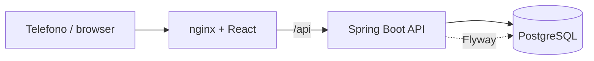

# Ortofrutta

Gestionale per il banco di frutta e verdura: **cassa**, **magazzino a lotti**, **scarti**, **margini reali**,
**ordini ai fornitori** (anche via WhatsApp), **prenotazioni dei clienti**, **corrispettivi giornalieri** e **registro delle attività**.
Interfaccia pensata per il telefono, da usare con una mano dietro al banco.

> Progetto full-stack + DevOps: Spring Boot, React, PostgreSQL, Docker, CI/CD, Kubernetes.

## Cosa fa

| Area | Funzioni |
|---|---|
| **Cassa** | Carrello con più prodotti, metodo di pagamento, incasso atomico (o passa tutto o niente), **storno** con ripristino della merce |
| **Magazzino** | Giacenze, lotti con scadenza, carico merce, scarti con motivo, storico movimenti paginato con l'operatore |
| **Lotti FIFO** | Ogni arrivo è un lotto con costo e scadenza; le vendite consumano prima il più vecchio, così il margine è reale |
| **Ordini fornitori** | Bozza, invio (link WhatsApp), arrivo merce con correzione di quantità/costo; precompilazione dai prodotti sotto scorta |
| **Prenotazioni** | Nuova → Pronta → Ritirata. Il ritiro diventa una vendita di cassa con il suo metodo di pagamento |
| **Corrispettivi** | Riepilogo giornaliero per aliquota IVA (imponibile e imposta scorporati) e per metodo di pagamento |
| **Report** | Incasso, valore magazzino, margine, scarti, più venduti, lotti in scadenza, report per prodotto |
| **Tipologiche** | Categorie, unità di misura, aliquote IVA, origini, motivi di scarto, metodi di pagamento, tipi di cliente: **solo l'admin le gestisce** |
| **Ruoli e permessi** | Ruoli personalizzabili con permessi granulari; 4 ruoli già pronti |
| **Registro attività** | Chi ha cambiato prezzi, utenti, ruoli, tipologiche, chi ha stornato una vendita |

## Tipologiche (tabelle di decodifica)

Valori "statici" che compaiono nei moduli e che solo chi ha il permesso `LOOKUPS_MANAGE` (l'amministratore) può aggiungere o modificare.
Ognuna è una tabella a sé, con chiavi esterne dai dati che la usano.

| Tipologica | Usata da | Note |
|---|---|---|
| Categorie prodotto | prodotti | Frutta, Verdura, Erbe aromatiche... |
| **Unità di misura** | prodotti, quantità ovunque | etichetta breve (kg, pz, mazzo) e **se ammette decimali**: i pezzi si vendono solo interi |
| **Aliquote IVA** | prodotti, corrispettivi | percentuale; l'aliquota si "congela" su ogni vendita, quindi cambiarla non altera il passato |
| Origini | prodotti | facoltativa |
| Motivi di scarto | scarti | si sceglie da elenco, non testo libero: i report degli scarti diventano confrontabili |
| Metodi di pagamento | cassa, prenotazioni, corrispettivi | |
| Tipi di cliente | clienti | facoltativo |

- I valori **non si cancellano** (i dati storici li usano): si **disattivano**, e non si possono più assegnare ai nuovi dati.
- Gli **stati dei flussi** (bozza/inviato/ricevuto, nuova/pronta/ritirata) *non* sono tipologiche: la logica del codice dipende da loro.
- Le tipologiche sono tenute in una **cache in memoria** (si rinnova ogni 60 s e dopo ogni modifica; un id sconosciuto forza una rilettura, quindi con più repliche un valore nuovo è usabile subito).

> Le aliquote IVA iniziali (4%, 5%, 10%, 22%) sono valori d'esempio. La migrazione assegna **4%** a tutti i prodotti già presenti
> (tipica per l'ortofrutta fresca): **fai verificare le aliquote dal commercialista** prodotto per prodotto.

## Utenti, ruoli e permessi

I permessi sono un elenco fisso nel codice (ogni permesso = una funzione); i **ruoli** sono dati nel database e li definisce l'amministratore.

| Ruolo (pronto all'uso) | Cosa fa |
|---|---|
| **Amministratore** | Tutto, sempre. È l'unico con utenti, ruoli e tipologiche. Non modificabile |
| **Responsabile** | Gestisce il negozio: cassa, storni, carico, ordini, costi, report, registro. **Non** cambia i prezzi di listino, né utenti/ruoli/tipologiche |
| **Commesso** | Vende (a prezzo di listino), registra scarti, clienti e prenotazioni. Non vede costi e margini |
| **Magazziniere** | Riceve la merce e gestisce gli ordini. Non usa la cassa |

Dall'app (*Altro → Ruoli e permessi*) puoi creare altri ruoli scegliendo i permessi. I permessi di amministrazione
(`USERS_MANAGE`, `ROLES_MANAGE`, `LOOKUPS_MANAGE`) **non sono assegnabili** ad altri ruoli. Alcuni permessi ne richiedono altri
(chi vende deve poter vedere il listino) e vengono aggiunti da soli.

- I permessi sono imposti dal **backend** (`SecurityConfig`, una sola matrice): nascondere un pulsante non basta, una chiamata non permessa risponde 403.
- Il token contiene solo il nome utente: **ruolo e permessi si rileggono dal database a ogni richiesta** (una query sola).
  Un utente disattivato o con permessi cambiati li perde subito.
- Chi non ha `COSTS_VIEW` non riceve mai costi di acquisto né margini; chi non ha `SALES_PRICE_OVERRIDE` vende sempre a listino.
- **Password temporanee**: finché l'utente non ne sceglie una sua, il server non gli concede nessun permesso. Vale anche per il primo accesso dell'admin.
- Un amministratore non può cambiare il proprio ruolo o disattivarsi.

## Efficienza

- **Cache delle tipologiche**: niente join né query ripetute per nomi, unità e aliquote.
- **Liste paginate** (movimenti, ordini, vendite, registro): il client chiede una pagina alla volta.
- **Niente query N+1**: i dati collegati si caricano insieme (`@EntityGraph`) o a blocchi (batch fetch).
- **Dashboard in meno query**: tutti gli importi in un'unica scansione dei movimenti.
- **Vendita atomica**: più righe in una sola transazione, con blocco sui lotti per evitare vendite concorrenti.
- **Compressione HTTP** (backend e nginx) e **frontend a pezzi**: ogni pagina si scarica solo quando serve (il codice di amministrazione non arriva al commesso).
- Indici sulle nuove query (vendite, movimenti per vendita, registro).

## Architettura



- **backend/**: Spring Boot 3.5, Java 21, Spring Data JPA, Spring Security (JWT), Flyway, springdoc-openapi, JdbcClient per i report
- **frontend/**: React 18, TypeScript, Vite, React Router (CSS proprio, mobile-first)
- **docker-compose.yml**: database e (con il profilo `app`) backend e frontend

Il backend è organizzato **per funzionalità** (`product`, `stock`, `sale`, `lookup`, `auth`, `report`, `audit`...).

## Avvio

### 1. Sviluppo: database in Docker, backend e frontend in locale

```bash
docker compose up -d                 # solo PostgreSQL
```

**Backend** (IntelliJ): apri `backend/pom.xml`, JDK 21, lancia `OrtofruttaApplication`.
Per i dati di prova aggiungi `SPRING_PROFILES_ACTIVE=demo`.

**Frontend** (Node 20.19+ o 22):
```bash
cd frontend && npm install && npm run dev      # http://localhost:5173
```

Accesso iniziale: `admin` / `admin123`: al primo accesso l'app chiede di scegliere una nuova password.
Con il profilo `demo` esistono anche `commesso` / `commesso123`, `responsabile` / `responsabile123`, `magazziniere` / `magazziniere123`.

### 2. Tutto in container

```bash
docker compose --profile app up --build        # app su http://localhost:3000, API su :8080
```

## CI/CD e deploy su Kubernetes

Ogni push su `master` esegue i test backend (`mvn verify`) e la build frontend. Se entrambi passano,
GitHub Actions pubblica le immagini `backend` e `frontend` su GHCR (tag commit e `latest`) e aggiorna
le risorse in `k8s/app.yaml`; il deploy attende il completamento dei rolling update. Le pull request
eseguono solo la CI.

Prima del primo push configura:

1. I secrets GitHub Actions `KUBE_CONFIG`, `GHCR_USERNAME` e `GHCR_READ_TOKEN` nelle impostazioni
   del repository. Il kubeconfig deve autorizzare il deploy nel namespace `default`; il token GHCR
   deve avere solo il permesso `read:packages` (e accesso ai package del repository). Non inserirli
   nel repository.
2. Nel cluster, il Secret `ortofrutta-config` nel namespace `default`, con le chiavi
   `SPRING_DATASOURCE_URL`, `SPRING_DATASOURCE_USERNAME`, `SPRING_DATASOURCE_PASSWORD`, `JWT_SECRET`
   (casuale e di almeno 32 caratteri) e `ADMIN_PASSWORD`.
3. Un database PostgreSQL raggiungibile dal cluster e già predisposto per l'app. Il database non è
   creato dai manifest Kubernetes: usa un servizio PostgreSQL gestito o installalo e configura backup
   persistenti prima di usare dati reali.
4. Il Service frontend è di tipo `LoadBalancer`; l'indirizzo esterno dipende dal provider Kubernetes.
   Il workflow crea/aggiorna `ghcr-pull-secret` usando i due secrets GHCR elencati sopra.

La migrazione **V3** è *additiva*: prima del rilascio su un database esistente fai un backup con
`pg_dump`. Backend e frontend vengono aggiornati insieme perché alcune API sono cambiate; Flyway
applica le migrazioni all'avvio del backend. Verifica le aliquote IVA prima di usare dati reali.

## Test locali

```bash
cd backend && mvn verify             # serve Docker acceso (Testcontainers)
cd frontend && npm run build         # controllo dei tipi + build
```

Se Testcontainers segnala che l'API Docker `1.32` è troppo vecchia, imposta
`JAVA_TOOL_OPTIONS=-Dapi.version=1.44` prima di eseguire Maven. La CI backend usa già questo override.

- `StockServiceTest`: logica FIFO, IVA congelata, quantità intere per le unità senza decimali (nessun database)
- `LookupSlugTest`: generazione dei codici delle tipologiche
- `ApiFlowTest`: carico, vendita, scarto, atomicità della vendita, paginazione
- `RolesTest`: permessi dei 4 ruoli, ruoli personalizzati, permessi riservati, password temporanee, utenti disattivati
- `LookupsTest`: solo l'admin crea tipologiche, duplicati, valori disattivati, regole su unità e IVA
- `SalesTest`: carrello, storno, corrispettivi per IVA (con vendite stornate escluse), ritiro prenotazioni, vendite visibili solo al proprio autore

I test di integrazione condividono **un solo PostgreSQL** (Testcontainers) e un solo contesto Spring.

## Configurazione

| Variabile | Significato | Default (solo sviluppo) |
|---|---|---|
| `JWT_SECRET` | Chiave di firma dei token, min. 32 caratteri | valore fisso di sviluppo |
| `ADMIN_USERNAME` / `ADMIN_PASSWORD` | Amministratore creato al primo avvio | `admin` / `admin123` |
| `ADMIN_MUST_CHANGE_PASSWORD` | Obbliga a cambiare la password al primo accesso | `true` |
| `SPRING_DATASOURCE_URL/USERNAME/PASSWORD` | Database | `localhost:5432/ortofrutta` |
| `SPRING_PROFILES_ACTIVE=demo` | Carica dati di prova | disattivo |

## Limiti noti

- Non sostituisce il registratore di cassa: i **corrispettivi** dell'app sono un prospetto interno, non la trasmissione fiscale.
- Un solo negozio (non multi-tenant).
- Il token resta valido fino a scadenza (8 ore) ma ogni richiesta ricontrolla l'utente; manca un "esci da tutti i dispositivi".
- I dati personali dei clienti richiedono informativa e misure GDPR per un uso commerciale.

## Roadmap DevOps

- [x] Dockerfile multi-stage, utente non root, CI base con GitHub Actions
- [x] Pubblicazione immagini GHCR e deploy GitHub Actions su Kubernetes
- [ ] Gate di sicurezza: Gitleaks, SAST (Semgrep/SonarQube), Trivy
- [ ] Helm chart + Argo CD
- [ ] Prometheus e Grafana
- [ ] Terraform + AWS
