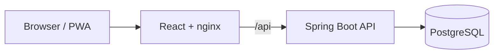

# Ortofrutta

Gestionale web multi-azienda per negozi di frutta e verdura. Riunisce vendite, magazzino, ordini e clienti in un'interfaccia mobile-first, installabile come PWA.

## Funzionalità

- **Cassa e vendite**: ricerca prodotti e codici a barre, pagamenti, clienti, storni e chiusura contanti.
- **Magazzino**: lotti con costo e scadenza, consumo FIFO, carichi, inventario, scarti e storico movimenti.
- **Ordini**: acquisti dai fornitori e prenotazioni dei clienti, con ritiro o consegna a domicilio.
- **Gestione**: anagrafiche, report, cartellini prezzo, ruoli e permessi configurabili, registro attività.
- **Portale clienti**: registrazione, catalogo e consultazione dei propri ordini.
- **Multi-azienda**: dati e permessi isolati per negozio.

Le aliquote IVA e altre tipologiche sono configurabili dall'amministratore. Verifica le aliquote con il commercialista prima di usare dati reali: la migrazione iniziale assegna il 4% ai prodotti esistenti.

## Tecnologie

| Componente | Stack |
|---|---|
| Backend | Java 21, Spring Boot 3.5, Spring Security, JPA, Flyway |
| Frontend | React 18, TypeScript, Vite |
| Database | PostgreSQL 16 |
| Container e deploy | Docker Compose, GHCR, Render; chart Helm disponibile |



## Avvio in locale

Prerequisiti: Git, Docker con Docker Compose, Java 21 e Maven per lo sviluppo backend, Node.js 22 per il frontend.

### Avvio completo con Docker

Dalla radice del repository:

```bash
docker compose --profile app up --build -d
```

Apri <http://localhost:3000>. L'API è disponibile su <http://localhost:8081>; PostgreSQL sulla porta `5433` dell'host. Il database nel container è raggiungibile dagli altri servizi come `db:5432`.

In ambiente locale Compose usa dati demo e credenziali predefinite (`admin` / `admin123`); al primo accesso l'amministratore deve cambiare password. **Non usare queste credenziali, i dati demo o il secret JWT predefinito in produzione.** Per fermare i servizi senza cancellare i dati:

```bash
docker compose --profile app down
```

Per eliminare anche il volume PostgreSQL locale:

```bash
docker compose --profile app down -v
```

### Sviluppo con servizi separati

Avvia il database:

```bash
docker compose up -d db
```

Poi, in due terminali:

```bash
mvn -f backend/pom.xml spring-boot:run
```

```bash
npm --prefix frontend ci
npm --prefix frontend run dev
```

Il frontend di sviluppo è disponibile su <http://localhost:5173>. Per caricare dati demo nel backend imposta `SPRING_PROFILES_ACTIVE=demo`. L'admin locale predefinito è `admin` / `admin123`.

## Test e controlli

```bash
mvn -B -f backend/pom.xml verify
npm --prefix frontend ci
npm --prefix frontend run build
helm lint helm/ortofrutta
```

I test backend di integrazione usano Testcontainers: Docker deve essere avviato. La build frontend esegue il controllo TypeScript e la build di produzione.

## CI e immagini Docker

GitHub Actions esegue la pipeline sui push a `collaudo` e `master` e sulle pull request:

1. test e verifica backend con Maven;
2. controllo TypeScript e build frontend;
3. scansione segreti con Gitleaks, lint Helm e scansione vulnerabilità con Trivy.

Solo un push su `master`, dopo il completamento dei controlli, pubblica le immagini su GitHub Container Registry (GHCR):

| Componente | Immagine |
|---|---|
| API | `ghcr.io/lollozorli/ortofrutta-backend` |
| Frontend | `ghcr.io/lollozorli/ortofrutta-frontend` |

Ogni immagine viene pubblicata con un tag corrispondente allo SHA del commit e con il tag mobile `latest`. Per deploy riproducibili, preferisci il tag SHA. I vecchi package `ortofrutta-app-backend` e `ortofrutta-app-frontend` eventualmente presenti su GHCR non vengono rimossi automaticamente.

## Collaudo e produzione

- **Collaudo**: lavora e verifica le modifiche sul branch `collaudo`. Il push esegue la CI, ma non pubblica immagini né aggiorna Render.
- **Produzione**: apri una pull request da `collaudo` a `master`. Il merge fa ripartire i controlli; dopo il successo, il workflow pubblica le immagini e Render può distribuire il commit di `master`.

Il file `render.yaml` definisce un frontend statico e un backend Docker; il database di produzione è esterno (Neon). Configura in Render le credenziali del database (`SPRING_DATASOURCE_URL`, `SPRING_DATASOURCE_USERNAME`, `SPRING_DATASOURCE_PASSWORD`) e `ADMIN_PASSWORD`. Render genera `JWT_SECRET`. Usa un secret JWT casuale di almeno 32 caratteri e non riutilizzare credenziali o database di collaudo.

Prima di collegare un database già in uso o applicare migrazioni, fai un backup. Flyway aggiorna lo schema all'avvio del backend. La PWA richiede HTTPS per l'installazione e una connessione al backend per autenticazione e dati.

## Deploy Kubernetes (opzionale)

Il chart Helm è separato dal deploy Render e non viene installato dalla CI. Configura prima i secret previsti dai valori del chart (`ortofrutta-config` e `ghcr-pull-secret`), quindi:

```bash
helm lint helm/ortofrutta
helm upgrade --install ortofrutta helm/ortofrutta \
  --namespace ortofrutta --create-namespace \
  --set backend.tag=<commit-sha> \
  --set frontend.tag=<commit-sha>
```

I repository predefiniti del chart sono `ghcr.io/lollozorli/ortofrutta-backend` e `ghcr.io/lollozorli/ortofrutta-frontend`.

## Configurazione

| Variabile | Uso |
|---|---|
| `SPRING_DATASOURCE_URL` | URL JDBC PostgreSQL; in Compose è configurato per `db:5432` |
| `SPRING_DATASOURCE_USERNAME`, `SPRING_DATASOURCE_PASSWORD` | Credenziali database |
| `JWT_SECRET` | Chiave di firma JWT; usa un valore casuale e privato in produzione |
| `ADMIN_USERNAME`, `ADMIN_PASSWORD` | Credenziali iniziali, applicate quando il database non contiene utenti |
| `ADMIN_MUST_CHANGE_PASSWORD` | Richiede il cambio della password iniziale |
| `SPRING_PROFILES_ACTIVE` | Attiva profili applicativi come `demo` o `prod` |
| `APP_CORS_ALLOWED_ORIGINS` | Origini abilitate per le richieste cross-origin |
| `PASSWORD_RESET_BASE_URL`, `PASSWORD_RESET_TOKEN_TTL` | URL pubblico e durata dei token di reset password |
| `SPRING_MAIL_HOST`, `SPRING_MAIL_PORT`, `SPRING_MAIL_USERNAME`, `SPRING_MAIL_PASSWORD` | Configurazione SMTP |
| `NOTIFICATION_RECIPIENT_EMAILS`, `NOTIFICATION_CRON` | Destinatari e orario delle notifiche |

Non inserire password, token o URL con credenziali nei commit. Configura i valori sensibili come secret nell'ambiente di deploy.

## Note

- L'app non sostituisce un registratore di cassa fiscale: i corrispettivi sono un prospetto gestionale interno.
- Per un uso commerciale, configura informativa e misure adeguate alla protezione dei dati personali.
- La documentazione tecnica delle API è esposta dal backend tramite Swagger UI su `/swagger-ui.html`.
