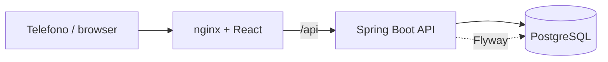

# Ortofrutta

Piattaforma multi-azienda per ortofrutta: ogni negozio gestisce **cassa**, **magazzino a lotti**, **scarti**, **margini reali**,
**ordini ai fornitori** (anche via WhatsApp), **prenotazioni dei clienti**, **corrispettivi giornalieri** e **registro delle attività**.
Interfaccia pensata per il telefono, da usare con una mano dietro al banco.

> Progetto full-stack + DevOps: Spring Boot, React, PostgreSQL, Docker, CI/CD, Kubernetes.

## Cosa fa

| Area | Funzioni |
|---|---|
| **Cassa** | Carrello con più prodotti, ricerca per nome o codice a barre, lettore USB/Bluetooth e scansione fotocamera nei browser compatibili, cliente facoltativo, metodo di pagamento, incasso atomico e **storno** con ripristino della merce |
| **Magazzino** | Giacenze, conteggio fisico con rettifica tracciata, lotti con scadenza, carico merce, scarti con motivo, storico movimenti paginato con l'operatore |
| **Lotti FIFO** | Ogni arrivo è un lotto con costo e scadenza; le vendite consumano prima il più vecchio, così il margine è reale |
| **Ordini fornitori** | Bozza, invio (link WhatsApp), arrivo merce con correzione di quantità/costo; precompilazione dai prodotti sotto scorta |
| **Ordini clienti** | Ritiro in negozio o consegna a domicilio con zona, tariffa e capienza per fascia/data configurabili. Nuovo → In preparazione → Ritirato/Consegnato. Il completamento crea la vendita e scarica il magazzino |
| **Corrispettivi** | Riepilogo giornaliero per aliquota IVA (imponibile e imposta scorporati) e per metodo di pagamento; chiusura contanti con differenza tra atteso e contato |
| **Clienti** | Anagrafica e storico acquisti associati alle vendite |
| **Portale clienti** | Registrazione con email e password, catalogo senza giacenze interne, invio e consultazione dei propri ordini |
| **Cartellini** | Stampa dei cartellini prezzo dei prodotti attivi e filtrati |
| **Report** | Incasso, valore magazzino, margine, scarti, più venduti, lotti in scadenza, report per prodotto |
| **Tipologiche** | Categorie, unità di misura, aliquote IVA, origini, motivi di scarto, metodi di pagamento, tipi di cliente e fornitore: **solo l'admin le gestisce** |
| **Ruoli e permessi** | Ruoli e permessi indipendenti per ogni azienda; 4 ruoli operativi e il ruolo Cliente |
| **Registro attività** | Chi ha cambiato prezzi, utenti, ruoli, tipologiche, chi ha stornato una vendita |

## Tipologiche (tabelle di decodifica)

Valori "statici" che compaiono nei moduli e che solo chi ha il permesso `LOOKUPS_MANAGE` (l'amministratore) può aggiungere o modificare.
Ognuna è una tabella a sé, con chiavi esterne dai dati che la usano.

| Tipologica | Usata da | Note |
|---|---|---|
| Categorie prodotto | prodotti | Frutta, Verdura, Erbe aromatiche... |
| **Unità di misura** | prodotti, quantità ovunque | etichetta breve (kg, pz, mazzo) e **se ammette decimali**: i pezzi si vendono solo interi |
| **Aliquote IVA** | prodotti, corrispettivi | percentuale; l'aliquota si "congela" su ogni vendita, quindi cambiarla non altera il passato |
| Origini | prodotti | facoltativa |
| Motivi di scarto | scarti | si sceglie da elenco, non testo libero: i report degli scarti diventano confrontabili |
| Metodi di pagamento | cassa, prenotazioni, corrispettivi | |
| Tipi di cliente | clienti | facoltativo |
| Tipi di fornitore | fornitori | azienda agricola/produttore, grossista, mercato, cooperativa, importatore; filtrabili nell'anagrafica. Quelli già presenti vengono classificati come "Altro" dalla migrazione |

- I valori **non si cancellano** (i dati storici li usano): si **disattivano**, e non si possono più assegnare ai nuovi dati.
- Gli **stati dei flussi** (bozza/inviato/ricevuto, nuova/pronta/ritirata) *non* sono tipologiche: la logica del codice dipende da loro.
- Le tipologiche sono tenute in una **cache in memoria** (si rinnova ogni 60 s e dopo ogni modifica; un id sconosciuto forza una rilettura, quindi con più repliche un valore nuovo è usabile subito).

> Le aliquote IVA iniziali (4%, 5%, 10%, 22%) sono valori d'esempio. La migrazione assegna **4%** a tutti i prodotti già presenti
> (tipica per l'ortofrutta fresca): **fai verificare le aliquote dal commercialista** prodotto per prodotto.

## Utenti, ruoli e permessi

I permessi sono un elenco fisso nel codice (ogni permesso = una funzione); i **ruoli** sono dati nel database e li definisce l'amministratore.

| Ruolo (pronto all'uso) | Cosa fa |
|---|---|
| **Amministratore** | Tutto, sempre. Ha la gestione completa di utenti, ruoli e tipologiche. Non modificabile |
| **Responsabile** | Gestisce il negozio: prodotti e prezzi, cassa, storni, carico, ordini, costi, report, registro; consulta commessi e clienti e approva le richieste staff. Non gestisce ruoli/tipologiche |
| **Cassiere** | Vende (a prezzo di listino), consulta i fornitori e crea ordini ai fornitori; registra scarti, clienti e prenotazioni. Non vede costi e margini |
| **Magazziniere** | Riceve la merce e gestisce gli ordini. Non usa la cassa |
| **Cliente** | Si registra con email e password, consulta il catalogo e crea/consulta solo i propri ordini |

Dall'app (*Altro → Ruoli e permessi*) puoi creare altri ruoli scegliendo i permessi. I permessi di amministrazione
(`USERS_MANAGE`, `ROLES_MANAGE`, `LOOKUPS_MANAGE`) **non sono assegnabili** ad altri ruoli. Alcuni permessi ne richiedono altri
(chi vende deve poter vedere il listino) e vengono aggiunti da soli.

- I permessi sono imposti dal **backend** (`SecurityConfig`, una sola matrice): nascondere un pulsante non basta, una chiamata non permessa risponde 403.
- Il token contiene solo il nome utente: **ruolo e permessi si rileggono dal database a ogni richiesta** (una query sola).
  Un utente disattivato o con permessi cambiati li perde subito.
- Chi non ha `COSTS_VIEW` non riceve mai costi di acquisto né margini; chi non ha `SALES_PRICE_OVERRIDE` vende sempre a listino.
- **Password temporanee**: finché l'utente non ne sceglie una sua, il server non gli concede nessun permesso. Vale anche per il primo accesso dell'admin.
- Un amministratore non può cambiare il proprio ruolo o disattivarsi.

## Aziende e isolamento dei dati

Ogni ortofrutta può registrarsi dalla schermata di accesso. Ogni azienda ha un catalogo, fornitori, clienti,
ruoli, utenti, magazzino, vendite e ordini separati. L'API seleziona l'azienda con l'header `X-Company-Slug`;
il frontend lo imposta quando si sceglie il negozio. I token vengono verificati contro l'iscrizione dell'utente
a quell'azienda, e permessi e record vengono riletti nel contesto dell'azienda per ogni richiesta.

L'identità di accesso del cliente è condivisa: per aggiungere un altro negozio allo stesso account, seleziona
quel negozio, scegli la registrazione cliente e inserisci la stessa email e password. Verrà creato un profilo
cliente distinto per l'azienda; ordini e dati personali di negozi diversi restano separati. I dati già presenti
nel database vengono migrati nell'azienda `ortofrutta` senza cancellarli.

La schermata iniziale offre quattro ingressi: accedi, registrazione cliente, richiesta di accesso come commesso e
registrazione azienda. Il commesso seleziona il negozio e crea l'account; il responsabile approva la richiesta da
**Altro → Commessi e richieste di accesso** prima che l'account possa entrare nel gestionale. Il cliente sceglie
un negozio dall'elenco e può cambiare negozio dal pulsante in alto; il logout è disponibile per tutti i ruoli.

Nel portale ordini il cliente sceglie tra ritiro e consegna a domicilio. Per la consegna inserisce indirizzo,
città, CAP e telefono, e sceglie una fascia oraria disponibile. In **Altro → Zone e fasce di consegna** il
responsabile delle prenotazioni configura le città servite (corrispondenza senza distinzione tra maiuscole e
minuscole), costo, minimo d'ordine e capienza massima per fascia e data. Il costo si aggiunge al totale e alla
vendita quando il negozio registra la consegna; tariffa e fascia restano salvate sull'ordine anche se la
configurazione viene modificata in seguito. Il ritiro in negozio mantiene il comportamento solo-data.

## Efficienza

- **Cache delle tipologiche**: niente join né query ripetute per nomi, unità e aliquote.
- **Liste paginate** (movimenti, ordini, vendite, registro): il client chiede una pagina alla volta.
- **Niente query N+1**: i dati collegati si caricano insieme (`@EntityGraph`) o a blocchi (batch fetch).
- **Dashboard in meno query**: tutti gli importi in un'unica scansione dei movimenti.
- **Vendita atomica**: più righe in una sola transazione, con blocco sui lotti per evitare vendite concorrenti.
- **Compressione HTTP** (backend e nginx) e **frontend a pezzi**: ogni pagina si scarica solo quando serve (il codice di amministrazione non arriva al commesso).
- Indici sulle nuove query (vendite, movimenti per vendita, registro).

## Architettura



- **backend/**: Spring Boot 3.5, Java 21, Spring Data JPA, Spring Security (JWT), Flyway, springdoc-openapi, JdbcClient per i report
- **frontend/**: React 18, TypeScript, Vite, React Router (CSS proprio, mobile-first)
- **docker-compose.yml**: database e (con il profilo `app`) backend e frontend

Il backend è organizzato **per funzionalità** (`product`, `stock`, `sale`, `lookup`, `auth`, `report`, `audit`...).

## Avvio

### 1. Sviluppo: database in Docker, backend e frontend in locale

```bash
docker compose up -d                 # solo PostgreSQL
```

**Backend** (IntelliJ): apri `backend/pom.xml`, JDK 21, lancia `OrtofruttaApplication`.
Per i dati di prova aggiungi `SPRING_PROFILES_ACTIVE=demo`.

**Frontend** (Node 20.19+ o 22):
```bash
cd frontend && npm install && npm run dev      # http://localhost:5173
```

Accesso iniziale: `admin` / `admin123`: al primo accesso l'app chiede di scegliere una nuova password.
Con il profilo `demo` esistono anche `commesso` / `commesso123`, `responsabile` / `responsabile123`, `magazziniere` / `magazziniere123`.

### 2. Tutto in container

```bash
docker compose --profile app pull              # scarica le immagini pubblicate su GHCR
docker compose --profile app up -d             # app su http://localhost:3000, API su :8081
```

PostgreSQL è raggiungibile dal PC su `localhost:5433`; i container si collegano invece al servizio Docker
`db:5432`. La porta `5432` del PC è già occupata e non può essere pubblicata da Docker.
Le richieste del frontend passano da nginx (`/api`) e restano sullo stesso origin: nginx non inoltra
l'header `Origin` al backend. `APP_CORS_ALLOWED_ORIGINS` in Compose autorizza comunque `http://localhost:3000`
se si interroga direttamente l'API dalla porta `8081`.

Per aggiornare l'app dopo una pubblicazione GitHub Actions, esegui `docker compose --profile app pull`
e poi `docker compose --profile app up -d`. Se GHCR segnala `denied`, autentica Docker con un token GitHub
che abbia `read:packages`, oppure rendi pubblici i package. Per provare modifiche ai sorgenti locali,
usa una configurazione Compose di sviluppo con `build` per backend e frontend.

### Installare l'app sul telefono

Il frontend è una **PWA**: non serve scaricare un APK né pubblicarla su uno store. Apri l'indirizzo
HTTPS dell'app dal telefono, poi usa **Installa app** nel menu di Chrome/Android oppure, su iPhone,
**Condividi → Aggiungi alla schermata Home**. In *Altro* trovi il pulsante d'installazione quando il
browser lo supporta. Il browser richiede HTTPS per installare; `localhost` vale solo sul dispositivo
che esegue il browser, quindi per il telefono serve un indirizzo HTTPS raggiungibile dal telefono.
L'interfaccia può aprirsi dalla cache, ma accesso, vendite e dati richiedono il backend raggiungibile.

## CI/CD e deploy su Kubernetes

Ogni push su `master` esegue i test backend (`mvn verify`) e la build frontend. Se entrambi passano,
il job `publish` costruisce e pubblica su GHCR le immagini `backend` e `frontend`, ciascuna con tag del commit
(immutabile) e `latest`. Questo pubblica le immagini su GHCR, ma non modifica i container sul PC: per
aggiornarli manualmente esegui `docker compose --profile app pull` e poi `docker compose --profile app up -d`.
Le pull request eseguono solo la CI. Il job `deploy`, distinto da `publish`, aggiorna Kubernetes solo se la
variabile repository `DEPLOY_KUBERNETES` è impostata a `true`.

Prima del primo push configura:

1. Aggiungi il secret GitHub Actions `KUBE_CONFIG` con un kubeconfig autorizzato a gestire il namespace
   `ortofrutta`, e la variabile repository `DEPLOY_KUBERNETES=true`. Il workflow usa il `GITHUB_TOKEN`
   per pubblicare i package; non serve un token GHCR per il job.
2. Se i package GHCR sono privati, crea nel namespace `ortofrutta` il secret `ghcr-pull-secret`
   con un token GitHub che abbia `read:packages` e accesso ai package. Se li rendi pubblici, il secret
   non è necessario: in tal caso rimuovi `imagePullSecrets` dai Deployment.
3. Prima del deploy crea nel namespace `ortofrutta` il Secret `ortofrutta-config` con le chiavi
   `SPRING_DATASOURCE_USERNAME`, `SPRING_DATASOURCE_PASSWORD`, `JWT_SECRET` (casuale e di almeno
   32 caratteri), `ADMIN_PASSWORD` e, se serve, `ADMIN_USERNAME`. Le credenziali PostgreSQL devono
   essere le stesse usate dal pod Postgres. Il manifest crea un PostgreSQL con PVC da 5Gi; per dati
   reali configura storage e backup adeguati oppure usa un database gestito e modifica il manifest.
4. Il Service frontend è di tipo `LoadBalancer` sulla porta 80; l'indirizzo esterno dipende dal
   provider Kubernetes. Il database e il backend sono esposti solo all'interno del cluster.

Il namespace, PVC, Deployment e Service sono definiti in `k8s/app.yaml`. Le immagini vengono prima
pubblicate su GHCR e poi impostate sui Deployment usando il tag immutabile del commit; il workflow
attende la fine dei rolling update.

Le migrazioni **V3–V7** aggiungono tipologiche e funzionalità senza cancellare i dati esistenti: V4 aggiunge
il codice a barre, V5 collega le vendite ai clienti, introduce la chiusura contanti e le rettifiche inventario,
V6 aggiunge gli account email dei clienti e V7 aggiorna la descrizione del ruolo Responsabile.
**V8** introduce il modello multi-azienda e assegna i dati esistenti allo shop `ortofrutta`; **V9** aggiunge
ritiro/consegna agli ordini clienti; **V10** aggiunge l'approvazione delle richieste staff e i permessi
aggiuntivi di responsabile e commesso; **V11** aggiunge gli indici per il catalogo clienti e la disponibilità.
**V12** aggiunge i token monouso per il reset password; **V13** aggiunge zone, tariffe e fasce di consegna configurabili;
**V14** aggiunge la classificazione dei fornitori.
Prima di aggiornare un database già usato, fai un backup. Flyway applica le migrazioni all'avvio del backend.
Verifica le aliquote IVA prima di usare dati reali.

Gli account dipendenti si creano da **Altro → Utenti** con password temporanea e ruolo; l'email è facoltativa
per gli utenti esistenti e diventa un metodo di accesso aggiuntivo. Il portale clienti permette invece
la registrazione autonoma: l'account riceve solo i permessi `CATALOG_READ`, `CUSTOMER_ORDER_CREATE` e
`CUSTOMER_ORDER_READ`, e il backend associa ogni ordine al cliente autenticato. Le richieste dei clienti
restano in stato **Nuovo** finché il negozio non le conferma. Per ora non è configurata la verifica email:
un cliente può accedere subito dopo essersi registrato.

## Demo online gratuita per un cliente

Per una prova online temporanea usa `render.demo.yaml`, non `render.yaml` (che crea risorse a pagamento).
La configurazione pubblica la PWA e l'API sui piani Free di Render e usa PostgreSQL Free di Neon:

1. Pubblica su GitHub il commit con `render.demo.yaml` e le ultime modifiche dell'app.
2. Crea un progetto PostgreSQL Free su [Neon](https://neon.com/), preferibilmente nella regione europea. Da **Connect**
   copia host, database, utente e password del ramo principale; conserva la stringa come segreto.
3. In Render scegli **New → Blueprint**, collega il repository e indica `render.demo.yaml` come percorso del Blueprint.
   Durante la configurazione inserisci le variabili richieste: `SPRING_DATASOURCE_URL` nel formato
   `jdbc:postgresql://HOST/DATABASE?sslmode=require` (usa l'host pooled di Neon), `SPRING_DATASOURCE_USERNAME`,
   `SPRING_DATASOURCE_PASSWORD`, una password robusta per `ADMIN_PASSWORD` e tre password robuste per gli account demo.
   Render genera `JWT_SECRET`; non inserire credenziali nel repository.
4. Attendi che il deploy di frontend e backend termini. Invia al cliente l'URL HTTPS del servizio statico
   `ortofrutta-demo`; per l'accesso di prova condividi l'utente `commesso` e il valore configurato in
   `DEMO_STAFF_PASSWORD`. Non condividere l'account `admin`.

La demo viene precaricata con dati fittizi al primo avvio. Chi ha accesso all'account demo può modificare o cancellare
i dati: non usarla per dati personali o operazioni reali. Su Render Free il backend si sospende dopo 15 minuti senza
traffico e può impiegare circa un minuto a ripartire; Neon Free sospende il database inattivo e ha limiti di risorse.
Render può sospendere un servizio Free che genera traffico anomalo verso database esterni. Sono servizi di prova,
senza garanzia di disponibilità; verifica i limiti correnti dei piani prima di invitare il cliente.

Per aggiornare la demo basta pubblicare le modifiche sul branch collegato e attendere i controlli CI. Per azzerare i
dati, elimina e ricrea il database Neon: il precaricamento demo ripartirà al successivo avvio dell'API.

## Pubblicare la PWA su Render

Il frontend React è statico e installabile come PWA; per login e dati ha comunque bisogno del backend Spring e di PostgreSQL. Il file `render.yaml` definisce frontend statico, API e database nella regione di Francoforte. Il frontend riceve un URL HTTPS `onrender.com`, quindi il dominio personalizzato è facoltativo.

1. Crea un account Render e collega il repository GitHub.
2. Da Render scegli **New → Blueprint**, seleziona questo repository e conferma `render.yaml`.
3. Inserisci una password robusta per `ADMIN_PASSWORD` quando richiesta. Render genera `JWT_SECRET` e le credenziali del database.
4. Attendi il completamento di frontend, backend e PostgreSQL, poi apri l'URL `onrender.com` del frontend.
5. Accedi come `admin` usando la password inserita e cambiala al primo accesso. Il Blueprint configura il deploy dopo i controlli GitHub.

La configurazione usa il piano backend da 2 GB e PostgreSQL da 1 GB: ai prezzi Render consultati a novembre 2026 sono circa **$44 al mese complessivi**; il frontend statico non ha un costo di compute. Possono aggiungersi IVA, traffico oltre la quota inclusa e spazio database. La stima cambia se Render aggiorna i prezzi. I piani gratuiti vanno bene per una prova, non per dati di negozio: il database gratuito scade dopo 30 giorni e i servizi gratuiti possono fermarsi.

Per installarla sul telefono apri l'URL HTTPS: su Android usa **Installa app** nel menu di Chrome; su iPhone usa **Condividi → Aggiungi alla schermata Home**. La PWA conserva la shell dell'interfaccia, ma le vendite e gli altri dati richiedono la connessione al backend.

## Test locali

```bash
cd backend && mvn verify             # serve Docker acceso (Testcontainers)
cd frontend && npm run build         # controllo dei tipi + build
```

Su Windows è necessario avere JDK 21 e Maven nel `PATH`, oppure usare il Maven integrato in IntelliJ.
Prima di eseguire i test Docker, avvia Docker Desktop e verifica con `docker info`.
In questa configurazione i test backend che richiedono PostgreSQL usano Testcontainers; quindi non bastano
solo JDK e Maven.

Per eseguire rapidamente i due test backend indipendenti da Docker:

```bash
cd backend
mvn -Dtest=StockServiceTest,LookupSlugTest test
```

Se Testcontainers segnala che l'API Docker `1.32` è troppo vecchia, imposta
`JAVA_TOOL_OPTIONS=-Dapi.version=1.44` prima di eseguire Maven. La CI backend usa già questo override.

- `StockServiceTest`: logica FIFO, IVA congelata, quantità intere per le unità senza decimali (nessun database)
- `LookupSlugTest`: generazione dei codici delle tipologiche
- `ApiFlowTest`: carico, vendita, scarto, atomicità della vendita, paginazione
- `RolesTest`: permessi dei ruoli operativi e Cliente, registrazione cliente, ruoli personalizzati, permessi riservati, password temporanee, utenti disattivati
- `LookupsTest`: solo l'admin crea tipologiche, duplicati, valori disattivati, regole su unità e IVA, tipo fornitore
- `SalesTest`: carrello, storno, corrispettivi per IVA (con vendite stornate escluse), ritiro prenotazioni, vendite visibili solo al proprio autore
- `CustomerPortalTest`: catalogo senza costi o giacenze, ordine al prezzo di listino, consegna a domicilio con tariffa/capienza, completamento con vendita e visibilità limitata ai propri ordini
- `CompanyIsolationTest`: registrazione aziende, utenti e ruoli separati, cataloghi e ordini isolati, account cliente condiviso fra negozi
- `EmployeeRegistrationTest`: richiesta commesso, accesso bloccato prima dell'approvazione e attivazione da parte del responsabile

I test di integrazione condividono **un solo PostgreSQL** (Testcontainers) e un solo contesto Spring.

## Configurazione

| Variabile | Significato | Default (solo sviluppo) |
|---|---|---|
| `JWT_SECRET` | Chiave di firma dei token, min. 32 caratteri | valore fisso di sviluppo |
| `ADMIN_USERNAME` / `ADMIN_PASSWORD` | Amministratore creato al primo avvio | `admin` / `admin123` |
| `ADMIN_MUST_CHANGE_PASSWORD` | Obbliga a cambiare la password al primo accesso | `true` |
| `SPRING_DATASOURCE_URL/USERNAME/PASSWORD` | Database | `localhost:5433/ortofrutta` dal PC; `db:5432/ortofrutta` nei container |
| `X-Company-Slug` | Azienda selezionata per le API | `ortofrutta` |
| `SPRING_PROFILES_ACTIVE=demo` | Carica dati di prova | disattivo |

## Funzioni di produzione

- Dalla pagina **Report** è possibile esportare i dati prodotti in CSV e stampare il prospetto.
- La schermata di accesso supporta la richiesta di reset password. Il token è casuale, salvato solo come hash,
  ha durata configurabile e viene invalidato dopo l'uso o una nuova richiesta.
- Gli avvisi automatici possono segnalare via email prodotti sotto scorta e lotti in scadenza.
- Il backend espone `/actuator/prometheus` per Prometheus e contiene annotazioni Helm per lo scraping.

| Variabile notifiche/reset | Significato |
|---|---|
| `SPRING_MAIL_HOST/PORT/USERNAME/PASSWORD` | Server SMTP per reset password e avvisi |
| `SPRING_MAIL_AUTH/STARTTLS` | Configurazione autenticazione SMTP |
| `PASSWORD_RESET_BASE_URL` | URL pubblico del frontend da inserire nel link di reset |
| `PASSWORD_RESET_TOKEN_TTL` | Durata del token reset, default `30m` |
| `NOTIFICATION_RECIPIENT_EMAILS` | Elenco email separate da virgola |
| `NOTIFICATION_CRON` | Programmazione avvisi, default 08:00 Europe/Rome |

Il deploy Kubernetes può usare anche il chart in `helm/ortofrutta`:

```bash
helm lint helm/ortofrutta
helm upgrade --install ortofrutta helm/ortofrutta \
  --namespace ortofrutta --create-namespace \
  --set backend.tag=<commit-sha> --set frontend.tag=<commit-sha>
```

La CI esegue Gitleaks, Trivy, lint Helm e la build backend/frontend prima della pubblicazione delle immagini.

## Limiti noti

- Non sostituisce il registratore di cassa: i **corrispettivi** dell'app sono un prospetto interno, non la trasmissione fiscale.
- Il token resta valido fino a scadenza (8 ore) ma ogni richiesta ricontrolla l'utente; manca un "esci da tutti i dispositivi".
- I dati personali dei clienti richiedono informativa e misure GDPR per un uso commerciale.

## Roadmap DevOps

- [x] Dockerfile multi-stage, utente non root, CI base con GitHub Actions
- [x] Pubblicazione immagini GHCR e deploy GitHub Actions su Kubernetes
- [ ] Gate di sicurezza: Gitleaks, SAST (Semgrep/SonarQube), Trivy
- [ ] Helm chart + Argo CD
- [ ] Prometheus e Grafana
- [ ] Terraform + AWS
